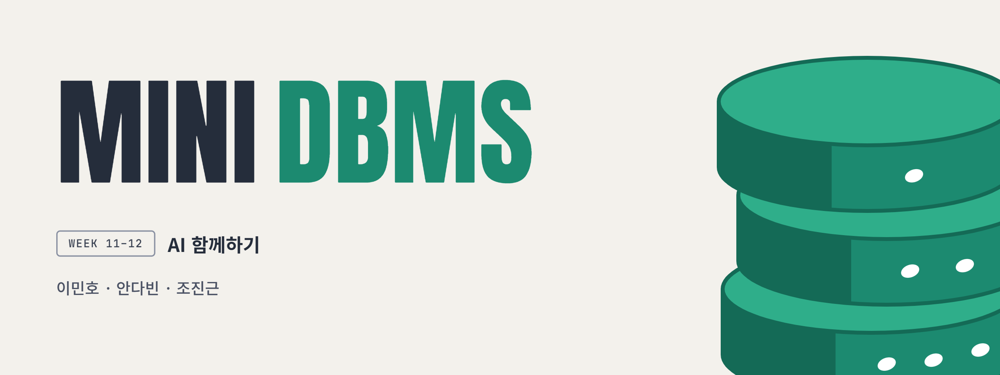

<!-- readme: archetype=team -->
<p align="center">
  
</p>

[](https://github.com/benjohnbill/mini-dbms/actions/workflows/ci.yml)


Krafton Jungle Week 11-12: SQL processor, B+ tree index, and a thread-pool API server

[소개](#소개) · [Phase](#phase) · [설치 및 실행](#설치-및-실행) · [개발 방식](#개발-방식) · [API](#api) · [구조](#구조) · [성능 비교](#성능-비교) · [알려진 한계](#알려진-한계) · [파일 트리](#파일-트리) · [문서](#문서) · [Team](#team)

> [!NOTE]
> 설계는 최종 PRD [`docs/prd/final.md`](docs/prd/final.md)에 있고, 구현 순서는 [`docs/prd/issues/`](docs/prd/issues/)의 티켓 01\~13입니다. 이 README는 `main`에 있는 코드의 현재 모습을 적습니다. API, 구조, 성능 비교, 알려진 한계 절은 각 절을 채우는 티켓이 구현과 함께 채웁니다. 각자의 PRD 초안도 [`docs/prd/`](docs/prd/)에 있습니다.

## 소개

mini-dbms는 C로 직접 만드는 작은 데이터베이스입니다. SQL 문장을 받아 데이터를 테이블 파일에 저장하고, 저장한 데이터를 다시 조회합니다.

과제는 세 Phase로 나뉩니다. 뒤 Phase는 앞 Phase에서 만든 것을 그대로 가져다 쓰므로, 세 Phase가 끝나면 하나의 DB 엔진이 완성됩니다.

Phase 1의 CLI와 Phase 3의 API 서버는 같은 DB 엔진을 호출합니다. 그래서 SQL을 처리하는 코드는 실행 파일의 `main()` 밖에 두고, CLI와 서버와 테스트가 함께 링크합니다.

## Phase

LMS는 과제를 세 단계로 나눕니다. 마일스톤은 따로 두지 않고, 최종 PRD 하나가 세 Phase를 모두 다룹니다.

| Phase | 만드는 것 | 확인할 것 | 요구사항 | 상태 |
|---|---|---|---|---|
| 1 | **SQL 처리기.** 텍스트 파일에 적은 SQL을 CLI로 넘기면 파싱하고 실행합니다. `INSERT`는 테이블 파일에 데이터를 더하고, `SELECT`는 테이블 파일에서 데이터를 읽어 출력합니다. | SQL이 올바르게 파싱되고 실행되는지 | L7\~L19, L35\~L38, L47 | 완료(티켓 01\~05) |
| 2 | **B+ 트리 인덱스.** 레코드가 추가될 때마다 ID를 자동으로 부여하고, 그 ID를 B+ 트리에 등록합니다. ID로 찾는 `SELECT`는 B+ 트리를 사용합니다. | 레코드 100만 건 이상에서 ID 조회(인덱스 사용)와 다른 필드 조회(처음부터 끝까지 탐색)의 속도 차이 | L20\~L26, L39\~L41, L48 | 완료(티켓 06\~08) |
| 3 | **API 서버.** 외부 클라이언트가 HTTP로 SQL을 보내면, 스레드 풀이 요청을 나눠 받아 병렬로 처리합니다. | 여러 요청이 동시에 들어와도 결과가 맞는지 | L27\~L30, L42\~L44, L49 | 완료(티켓 09\~13) |

요구사항 ID는 [`docs/requirements.md`](docs/requirements.md)에 있습니다. L50(엣지 케이스)은 모든 Phase의 테스트에 들어갑니다. 개발 환경(빌드, 테스트 도구, 코드 규칙 검사, CI)은 준비를 마쳤습니다.

## 설치 및 실행

Linux나 macOS에서 빌드합니다. Windows에서는 WSL2 안에서 빌드합니다.

빌드와 검증에 쓰는 도구입니다. acutest는 레포에 들어 있어서 따로 설치하지 않습니다.

| 도구 | 버전 | 용도 |
|---|---|---|
| C 컴파일러 | gcc 또는 clang (C11) | 빌드합니다. 테스트에 쓰는 AddressSanitizer와 UBSan도 컴파일러에 들어 있습니다 |
| make | 아무 버전 | 빌드와 검사 명령을 실행합니다 |
| python3 | 아무 버전 | 기능 테스트, ID 검사, 코드 규칙 검사 스크립트를 실행합니다 |
| clang-format, clang-tidy | 21.1.8, 21.1.6 (CI와 같은 버전) | 코드 모양과 이름 규칙을 검사합니다 |
| [acutest](https://github.com/mity/acutest) | 레포에 포함 (`tests/acutest.h`) | 단위 테스트를 작성하고 실행합니다 |

코드 규칙 검사 도구는 pip로 설치합니다. 버전이 다르면 같은 코드를 다르게 판정하므로, 꼭 CI와 같은 버전을 설치합니다.

```bash
pip install clang-format==21.1.8 clang-tidy==21.1.6
```

저장소를 내려받은 뒤 `make verify`로 빌드부터 코드 규칙 검사까지 실행합니다.

```bash
git clone https://github.com/benjohnbill/mini-dbms.git
cd mini-dbms
make verify
```

`make`로 CLI(`build/mini-dbms`)를 빌드합니다. CLI는 데이터 폴더와 SQL 파일을 받습니다.

```text
mini-dbms [--data 폴더] [-q] <SQL 파일>
```

데이터 폴더에는 테이블마다 스키마 파일과 빈 테이블 파일을 미리 만들어 둡니다. 엔진은 두 파일을 만들지 않습니다. 스키마 파일은 한 줄에 field 하나(`이름 INT` 또는 `이름 TEXT`)를 적고, `id`는 적지 않습니다. 테이블 이름은 파일 이름입니다. `--data`를 생략하면 `data/`를 씁니다. `INT`는 64비트 부호 있는 정수이고(PostgreSQL과 MySQL의 `INT`는 32비트), `TEXT` 값 하나는 최대 1 MiB입니다.

```bash
make
mkdir -p data
printf 'name TEXT\nemail TEXT\nage INT\n' > data/users.schema
: > data/users.tbl
cat > example.sql <<'SQL'
INSERT INTO users VALUES ('kim', 'kim@example.com', 20);
SELECT * FROM users;
SQL
./build/mini-dbms example.sql
```

CLI는 SQL 파일의 문장을 위에서부터 하나씩 실행하고 첫 오류에서 멈춥니다. SELECT 결과는 stdout에 TSV로 씁니다. 첫 줄은 field 이름이고 첫 field는 `id`입니다. `TEXT` 안의 탭, 줄바꿈, 역슬래시는 `\t`, `\n`, `\\`로 적습니다. 종료 코드는 0(성공), 1(파일·SQL·실행 오류), 2(잘못된 인자)입니다.

```text
id	name	email	age
1	kim	kim@example.com	20
```

문장마다 stderr에 메타 줄 하나를 씁니다. INSERT는 `-- 1 record inserted, id 3`, SELECT는 `-- 2 records, SCAN, examined 5, 0.02 ms` 모양입니다. `-q`는 INSERT의 메타 줄을 끕니다(100만 건 적재용). 오류는 `2번째 줄: VALUES 다음에 '('가 와야 합니다`처럼 SQL 파일의 줄 번호와 함께 stderr에 씁니다. SQL 파일에 NUL 바이트가 있으면 문장을 하나도 실행하지 않고 종료 코드 1로 끝납니다.

데이터 파일은 바이너리라 에디터로 읽을 수 없습니다. `dump` 명령은 테이블 하나의 record를 `SELECT * FROM <테이블>;`과 같은 TSV로 stdout에 씁니다. 없는 테이블이면 종료 코드 1입니다.

```text
mini-dbms [--data 폴더] dump <테이블>
```

```bash
./build/mini-dbms dump users
```

필요한 검사만 따로 실행할 수도 있습니다.

| 명령 | 하는 일 |
|---|---|
| `make` | CLI, API 서버(`build/mini-dbms-server`), 단위 테스트를 빌드합니다 |
| `make test` | 단위 테스트를 실행합니다 |
| `make functional` | CLI와 API 서버를 바깥에서 실행하는 기능 테스트를 실행합니다. 서버 기능 테스트는 서버를 띄워 실제 HTTP 요청을 보냅니다 |
| `make lint` | 코드 모양, 이름, 중괄호 규칙을 검사합니다 |
| `make format` | 코드 모양 위반을 자동으로 고칩니다 |
| `make clean` | `build/` 폴더를 지웁니다 |

## 개발 방식

### 검증

PR을 올리거나 고칠 때마다 GitHub Actions가 `make verify`를 실행합니다. 결과는 PR 하단에 표시됩니다. PR을 올리기 전에 로컬에서도 같은 명령으로 아래 항목을 확인할 수 있습니다.

1. **빌드.** 경고를 오류로 보고 빌드합니다(`-Wall -Wextra -Werror`).
2. **단위 테스트.** AddressSanitizer와 UBSan을 켠 채 실행합니다. 메모리를 잘못 다루거나 정의되지 않은 동작이 생기면 그 자리에서 테스트가 멈춥니다.
3. **기능 테스트.** `tests/functional/`의 스크립트가 빌드한 CLI를 실제로 실행하고 결과를 확인합니다.
4. **설계 문서 참조 검사.** 설계 문서에서 가리키는 테스트 ID와 설계 결정 기록(ADR)이 실제로 있는지 확인합니다.
5. **코드 규칙 검사.** `.clang-format`과 `.clang-tidy`의 규칙을 지켰는지 확인합니다.

### 코드 규칙

코드 모양은 mini-redis와 같은 규칙을 씁니다. Linux 커널 스타일을 바탕으로 들여쓰기는 스페이스 4칸, 한 줄은 80열이고, 중괄호는 한 줄짜리 본문에도 항상 씁니다. 이름은 snake_case로 짓고, 반복 변수 `i`, `j`, `k` 같은 예외를 빼면 3글자보다 짧은 이름은 쓰지 않습니다.

도구가 잡지 못하는 이름과 함수 규칙은 리뷰에서 확인합니다. 팀 규칙과 작업 흐름은 [`CONVENTION.md`](CONVENTION.md)에 있습니다.

## API

Phase 3에서 외부 클라이언트가 DBMS를 부르는 방법입니다. `POST /query`에 SQL 문장 하나를 본문으로 보내고 JSON을 받는 HTTP/1.1 API입니다(`docs/prd/final.md` § Phase 3). 종료와 큰 결과 나눠 받기(커서)는 티켓 12, 13이 이 절에 더합니다.

### 서버 실행

`make`가 CLI와 함께 API 서버(`build/mini-dbms-server`)를 빌드합니다. 서버는 CLI와 같은 데이터 폴더를 씁니다. 엔진이 데이터 폴더를 잠그므로 서버가 도는 동안 같은 폴더로 CLI를 실행할 수 없습니다.

```text
mini-dbms-server [--data 폴더] [--host 주소] [--port 포트] [--threads 수] [--queue 수] [--idle-timeout 밀리초] [--shutdown-wait 밀리초]
```

| 인자 | 기본값 | 뜻 |
|---|---|---|
| `--data` | `data` | 데이터 폴더 |
| `--host` | `127.0.0.1` | 연결을 받을 주소. 시연용입니다. 서버에는 인증이 없으므로, 다른 주소를 열면 그 주소에 닿는 누구나 SQL을 실행합니다 |
| `--port` | `8080` | 포트 |
| `--threads` | `8` | 작업 스레드 수 |
| `--queue` | `128` | 작업 대기열 칸 수. `0`이면 모든 SQL 요청을 `503 queue_full`로 거절합니다 |
| `--idle-timeout` | `30000` | 주고받은 바이트가 없는 연결을 서버가 닫기까지의 밀리초. 응답을 기다리는 연결은 닫지 않습니다 |
| `--shutdown-wait` | `5000` | SIGINT 뒤 마지막 작업이 끝나고 남은 응답 전송을 기다리는 최대 밀리초 |

`make functional`은 이 서버를 띄워 실제 HTTP 요청을 보내는 기능 테스트도 실행하고, `make tsan`은 ThreadSanitizer로 빌드한 서버로 같은 테스트를 다시 돌립니다. 잘못된 인자는 사용법을 stderr에 쓰고 종료 코드 2로 끝납니다. 엔진을 만들지 못하거나 포트를 열지 못하면 종료 코드 1입니다.

```bash
./build/mini-dbms-server --port 8080 &
printf "INSERT INTO users VALUES ('kim', 'kim@example.com', 20);" > q.sql
curl --data-binary @q.sql http://127.0.0.1:8080/query
# {"inserted": 1, "id": 1}
curl --data-binary 'SELECT * FROM users WHERE id = 1;' http://127.0.0.1:8080/query
# {"fields": ["id", "name", "email", "age"], "records": [[1, "kim", "kim@example.com", 20]], "access_path": "INDEX", "records_examined": 1}
```

### 요청 처리 흐름

이벤트 루프 스레드 하나가 Mongoose로 연결을 받고, 받은 바이트에서 요청을 직접 잘라 헤더와 본문 길이를 검사한 뒤, 본문을 다 받은 요청의 SQL만 복사해 작업 대기열에 넣습니다. Mongoose의 HTTP 처리기는 쓰지 않습니다. 그 처리기는 잘못된 본문 길이 헤더에 응답 없이 연결을 닫기 때문입니다. 작업 스레드는 대기열에서 요청을 꺼내 엔진을 API 모드(다음 문장 위치 없이)로 부르고, 만든 JSON을 완료 대기열에 넣은 뒤 `mg_wakeup()`으로 이벤트 루프를 깨우기만 합니다. 응답은 이벤트 루프만 보냅니다. 이벤트 루프는 poll마다 완료 대기열을 비우고, 그 사이 연결이 끊긴 요청의 결과는 해제합니다. 응답은 비차단으로 보내므로 느린 클라이언트가 작업 스레드와 테이블 잠금을 붙잡지 않습니다. 이벤트 루프는 poll(100ms)마다 연결의 마지막 송수신 시각을 보고, `--idle-timeout` 동안 바이트가 오가지 않은 연결을 닫습니다.

대기열에 들어간 INSERT는 연결이 끊겨도 끝까지 실행해 테이블 파일에 남습니다. 그래서 응답을 받지 못한 클라이언트가 같은 INSERT를 다시 보내면 record가 중복될 수 있습니다. 서버는 이 둘을 구분하지 않습니다.

#### keep-alive

HTTP/1.1 연결은 다시 씁니다. 한 연결에 요청을 여러 개 이어 보내면, 서버는 앞 요청의 응답을 송신 버퍼에 넣은 뒤 다음 요청을 꺼내므로 응답은 보낸 순서로 옵니다. 응답을 기다리는 동안에는 그 연결에서 더 읽지 않습니다. 여러 연결의 요청은 작업 스레드들이 병렬로 처리합니다.

`Connection: close` 요청과 `Connection: keep-alive`가 없는 HTTP/1.0 요청에는 응답에 `Connection: close`를 넣고, 보낸 뒤 연결을 닫습니다. 같은 연결에 이어 보낸 SQL은 실행하지 않습니다. 닫을지는 요청을 받을 때 정해 두었다가 응답할 때 씁니다. 본문 길이를 믿을 수 없어 다음 요청이 어디서 시작하는지 모르는 거절(`411`, `413`, `431`, `invalid_body_length`, `invalid_request`)도 연결을 닫습니다.

### 요청

`POST /query`이고 본문은 SQL 문장 하나입니다. 문장 뒤에 다른 문장이 있으면 어느 문장도 실행하지 않고 `400 multiple_statements`로 거절합니다. 문장 뒤의 공백은 괜찮습니다.

본문 길이는 `Content-Length` 하나로 보냅니다. chunked(`Transfer-Encoding`)는 받지 않습니다. 헤더(요청 줄 포함)는 8 KiB, 본문은 1 MiB까지 받습니다. 둘의 합은 Mongoose의 연결당 수신 버퍼 한도(`MG_MAX_RECV_SIZE`, 3 MiB)보다 작습니다. 그 한도에 먼저 걸리면 Mongoose가 응답 없이 연결을 닫기 때문입니다. 서버는 헤더를 다 받은 때 길이 표기와 상한을 먼저 확인하므로 1 MiB를 넘는 본문은 받기 전에 거절합니다. 선언한 길이만큼 본문을 받기 전에 끊긴 요청은 실행하지 않습니다.

결과 상한은 record 1만 건, 값의 누적 16 MiB(`INT`는 8바이트, `TEXT`는 바이트 길이), JSON 응답 32 MiB입니다. 결과가 상한에 닿으면 서버는 거기까지의 record와 `next_cursor`를 돌려줍니다. 엔진은 record 수와 값의 바이트로 멈추고, 서버는 record마다 JSON 길이를 재어 32 MiB 앞에서 한 번 더 자릅니다. record 하나가 값 16 MiB나 JSON 32 MiB를 넘으면 나눌 수 없으므로 `400 result_too_large`입니다. CLI에는 결과 상한이 없고 나눠 받지 않습니다.

#### 큰 결과 나눠 받기

`next_cursor`는 아직 받지 않은 다음 record가 테이블 파일에서 시작하는 바이트 위치입니다. 다음 부분은 같은 SQL을 `POST /query?cursor=<next_cursor>`로 다시 보내 받습니다. 마지막 부분에는 `next_cursor`가 없습니다. 정확히 1만 건인 결과도 한 부분이고 `next_cursor`가 없습니다.

```bash
curl -s --data-binary 'SELECT * FROM users;' http://127.0.0.1:8080/query
# {"fields": [...], "records": [...1만 건...], ..., "next_cursor": 620000}
curl -s --data-binary 'SELECT * FROM users;' 'http://127.0.0.1:8080/query?cursor=620000'
```

서버는 커서 위치에서 SCAN을 시작하고, 테이블의 읽기 잠금은 한 부분을 읽는 동안만 쥡니다. 그래서 부분 사이의 INSERT는 기다리지 않습니다. 테이블 파일은 덧붙이기만 하므로 부분 사이에 들어간 record는 조건에 맞으면 뒤 부분에만 나오고, 앞서 받은 record가 다시 나오거나 빠지지 않습니다. 커서는 record가 시작하는 위치이거나 파일 끝이어야 합니다. 서버는 그 위치의 record를 읽고, 그 `id`를 B+ 트리에서 찾아 같은 위치가 나오는지 봅니다. 질의 문자열은 `cursor=<0 이상의 정수>` 하나만 받습니다. `WHERE id = 정수`(INDEX 경로)와 INSERT에는 커서를 붙이지 않습니다. 부분 크기 1만은 측정으로 정했습니다([`docs/measurements/002-CJG-cursor-part-size.md`](docs/measurements/002-CJG-cursor-part-size.md)).

### 응답

모든 응답은 `Content-Type: application/json`입니다. `INT`와 `id`는 double을 거치지 않은 JSON 숫자이고, `TEXT`는 JSON 문자열입니다.

| 결과 | 상태 | 본문 |
|---|---|---|
| SELECT 성공 | `200` | `{"fields": [...], "records": [[...], ...], "access_path": "INDEX", "records_examined": 1}`. 결과가 0건이면 `records`는 `[]`입니다. 결과 상한에 닿아 나뉜 부분에는 `"next_cursor": <정수>`가 붙습니다 |
| INSERT 성공 | `200` | `{"inserted": 1, "id": 3}` |
| 오류 | 아래 표 | `{"error": "<오류 이유>", "message": "<사람이 읽는 설명>"}` |

### 상태 코드

| 상태 | 오류 이유 | 언제 |
|---|---|---|
| `400` | `syntax_error`, `table_not_found`, `field_not_found`, `type_mismatch`, `value_count_mismatch`, `int_out_of_range`, `text_too_long` | SQL 오류 |
| `400` | `multiple_statements` | 본문에 문장이 둘 이상 |
| `400` | `no_statement` | 빈 본문, 또는 공백만 있는 본문 |
| `400` | `invalid_sql_body` | 본문에 NUL 바이트(`0x00`)가 있음 |
| `400` | `result_too_large` | record 하나가 값 16 MiB 또는 JSON 32 MiB를 넘음 |
| `400` | `invalid_cursor` | 커서가 record 시작이나 파일 끝이 아님, 파일 크기보다 큼, 0 이상의 정수가 아님, 질의 문자열이 `cursor=` 하나가 아님, 또는 INDEX 경로의 SELECT나 INSERT에 커서가 붙음 |
| `400` | `invalid_body_length` | `Content-Length`가 숫자가 아니거나 여러 번 옴, 또는 `Transfer-Encoding`과 함께 옴. 연결을 닫습니다 |
| `400` | `invalid_request` | 요청 줄이나 헤더를 HTTP로 읽을 수 없음. 연결을 닫습니다 |
| `404` | `route_not_found` | `/query`가 아닌 경로 |
| `405` | `method_not_allowed` | `/query`에 POST가 아닌 메서드. `Allow: POST` 헤더를 같이 보냅니다 |
| `411` | `length_required` | `Content-Length` 없이 chunked로 보낸 요청(연결을 닫습니다), 또는 `Content-Length`가 없는 `POST /query` |
| `413` | `body_too_large` | 헤더를 정상으로 읽었고 선언한 본문 길이가 1 MiB를 넘음. 연결을 닫습니다 |
| `431` | `header_too_large` | 헤더가 8 KiB를 넘음. 연결을 닫습니다 |
| `500` | `storage_error`, `table_unavailable`, `out_of_memory` | 테이블 파일 쓰기나 읽기 실패, 되돌리기도 실패해 멈춘 테이블, 메모리 부족 |
| `500` | `id_exhausted` | 테이블의 ID가 `INT` 최댓값(`2^63 − 1`)에 닿아 INSERT가 새 ID를 받을 수 없음 |
| `503` | `queue_full` | 작업 대기열이 가득 참. 기다리지 않고 바로 답합니다 |
| `503` | `shutting_down` | SIGINT를 받은 뒤 열린 keep-alive 연결로 온 새 요청. `Connection: close`를 붙이고 연결을 닫습니다 |

## 구조

SQL 한 문장이 CLI나 API 서버에서 엔진, 잠금, 데이터 파일까지 가는 길을 `src/`의 파일과 함수 이름으로 그립니다. 화살표는 호출이고, 괄호 안은 그 함수가 있는 파일입니다.

```text
CLI (src/cli.c)                     API 서버 (src/server.c)
main                                [이벤트 루프 스레드]
 └ sql_run                           connection_event_handle
    └ engine_execute(sql, &next_sql)  → requests_handle → request_take
      문장 하나씩, 다음 문장 위치로     → request_route → request_submit
      다시 부름                         → work_queue_submit (src/work_queue.c)
                                    [작업 스레드]
                                     request_execute
                                      → engine_execute(sql, NULL)
                                        또는 engine_execute_from(sql, cursor)
                                      → result_json_create  (잠금 밖)
                                      → done_queue_push → mg_wakeup
                                    [이벤트 루프 스레드]
                                     done_replies_send → reply_send
              │                                  │
              └────────────────┬─────────────────┘
                               ▼
엔진 (src/engine.c)  execute_statement
 ├ sql_parse (src/sql.c)                       잠금 밖: 토크나이저, 파서
 └ engine_find_table → execute_on_table
    ├ insert_check / select_check → select_plan
    │                                          잠금 밖: 스키마 검증, 접근 경로
    └ execute_locked
       ├ rwlock_write_lock / rwlock_read_lock  테이블마다 쓰기 우선 잠금
       │                                       (src/rwlock.c)
       ├ INSERT: execute_insert → table_insert (src/table.c)
       │          bptree_reserve → write_full(pwrite) → bptree_insert
       │          → committed_size 올림. 쓰기 실패면 ftruncate로 되돌림
       └ SELECT: execute_select → select_iterator_create
                  ├ INDEX: table_index_create → bptree_find → record 1개 pread
                  └ SCAN:  table_scan_create(cursor) → scan_next(pread)
                               ▼
데이터 폴더: <테이블>.schema, <테이블>.tbl, .lock

시작할 때: engine_create → engine_lock_data_dir(flock)
           → engine_load_tables → table_create → table_records_load
             (잘림과 손상 판정, 다음 ID, B+ 트리 다시 만들기)
```

## 성능 비교

`make bench`가 100만 record를 생성해 CLI로 넣고, 같은 record를 ID 기준 SELECT(INDEX)와 다른 필드 기준 SELECT(SCAN)로 찾아 잽니다.

- **INDEX 대 SCAN:** INDEX는 중앙값 0.8\~1.6 µs, p99 2.5 µs 이하이고, SCAN은 중앙값 567\~857 ms입니다. INDEX는 record 1개를, SCAN은 1,000,000개를 읽습니다. 같은 ID를 강제로 SCAN해도 같은 범위라, 차이는 접근 경로에서 나옵니다. 모든 쌍에서 두 경로의 결과가 같은 record였습니다.
- **노드 크기:** 16, 32, 64, 128 중 메모리가 가장 적고 삽입이 가장 빠른 128로 정했습니다.

측정 기록: [`docs/measurements/001-CJG-index-vs-scan.md`](docs/measurements/001-CJG-index-vs-scan.md). 측정 기록은 [`docs/measurements/`](docs/measurements/)에 측정 한 번마다 파일 하나로 남깁니다.

## 알려진 한계

티켓마다 그 티켓이 만드는 한계를 한 줄씩 더합니다(티켓 01, 02, 04, 10, 12, 13). 전체 목록은 `docs/prd/final.md` § Further Notes에 있고, 일부러 하지 않는 기능은 같은 문서의 Out of Scope에 있습니다.

- `fsync`를 하지 않아 정전 때 성공을 알린 record를 잃을 수 있습니다(`docs/prd/final.md` § 공통, 영속성).
- CLI가 오류에서 멈춰도 그 앞에서 성공한 INSERT는 테이블 파일에 남습니다. 트랜잭션이 없기 때문입니다(`docs/prd/final.md` § Phase 1, CLI).
- 우리 `INT`는 64비트이고 PostgreSQL과 MySQL의 `INT`(32비트)와 다릅니다(`docs/prd/final.md` § Phase 1, 타입).
- 길이 칸은 맞고 `TEXT` 바이트만 바뀐 손상은 찾지 못합니다. 체크섬(CRC)이 없기 때문입니다([`docs/prd/issues/04-detect-damaged-table-file.md`](docs/prd/issues/04-detect-damaged-table-file.md)).
- 깨진 테이블 파일은 사람이 고쳐야 다시 시작합니다. 엔진은 `잘림`이나 `손상`을 찾으면 파일 이름, 바이트 위치, record 번호를 알리고 멈출 뿐, 파일을 고치지 않습니다.
- JSON 정수는 JavaScript 안전 정수 범위 `±(2^53 − 1)`를 넘으면 클라이언트에서 정밀도를 잃습니다. 서버는 64비트 정수를 그대로 JSON 숫자로 보내지만, JavaScript의 `JSON.parse`는 숫자를 double로 읽기 때문입니다(`docs/prd/final.md` § Phase 3, 응답).
- `SIGKILL`처럼 서버가 처리할 수 없는 종료는 쓰는 중이던 INSERT의 record를 잘라 남길 수 있고, 그러면 다음 시작이 멈춥니다. SIGINT는 실행 중인 작업을 끝까지 기다립니다([`docs/prd/issues/12-server-shutdown.md`](docs/prd/issues/12-server-shutdown.md)).
- 커서로 나눠 받은 결과는 한 시점의 스냅샷이 아닙니다. 부분 사이의 INSERT는 뒤 부분에 나옵니다. 이 성질은 테이블 파일이 덧붙이기만 한다는 데 기대므로, UPDATE나 DELETE를 범위에 넣으면 커서 설계를 다시 검토합니다([`docs/prd/issues/13-cursor-paging-for-large-results.md`](docs/prd/issues/13-cursor-paging-for-large-results.md)).

## 파일 트리

```
mini-dbms/
├─ Makefile          make verify, make test, make functional, make lint,
│                    make tsan, make bench, make bench-cursor
├─ LICENSE           GPLv2 (Mongoose를 함께 배포하기 때문)
├─ src/
│  ├─ cli.c          CLI 진입점. SQL 파일을 문장 하나씩 엔진에 넘기고 TSV로 출력, dump 명령
│  ├─ server.c       API 서버 진입점. Mongoose 이벤트 루프, POST /query, JSON 응답
│  ├─ work_queue.[ch]  작업 스레드와 작업 대기열
│  ├─ engine.[ch]    엔진 공개 함수(engine_create, engine_execute,
│  │                 engine_execute_from, engine_result_destroy,
│  │                 engine_destroy), 데이터 폴더 잠금, 결과 상한과 커서,
│  │                 planner(INDEX 또는 SCAN), 테이블마다 쓰기 우선 잠금
│  ├─ rwlock.[ch]    쓰기 우선 읽기·쓰기 잠금(mutex와 조건 변수 두 개)
│  ├─ sql.[ch]       토크나이저와 재귀 하강 파서
│  ├─ table.[ch]     스키마 파일, 바이너리 테이블 파일, 시작할 때 읽기와 깨진
│  │                 파일 판정, INSERT 쓰기와 되돌리기, SCAN과 INDEX iterator
│  ├─ bptree.[ch]    메모리 B+ 트리(id → 위치)
│  ├─ value.h        field 값 하나(INT, TEXT)
│  ├─ bench.c        측정 프로그램(make bench). 엔진을 직접 링크합니다
│  └─ engine_bench.h 측정 전용 강제 SCAN 스위치
├─ vendor/mongoose/  Mongoose 7.23(가져온 코드)
├─ tests/
│  ├─ engine_test.c      엔진 함수 네 개로 확인하는 단위 테스트
│  ├─ bptree_test.c      B+ 트리 단위 테스트
│  ├─ rwlock_test.c      쓰기 우선 잠금 단위 테스트
│  ├─ work_queue_test.c  작업 대기열 단위 테스트
│  ├─ acutest.h          단위 테스트 도구(가져온 코드)
│  └─ functional/
│     ├─ cli_test.py        CLI 실행 파일 기능 테스트
│     ├─ server_test.py     API 서버 기능 테스트
│     └─ generator_test.py  100만 건 생성 스크립트 테스트
├─ scripts/
│  ├─ generate-users.py  시드를 고정한 INSERT 문 SQL 파일 생성
│  ├─ bench.py           100만 건 적재와 INDEX 대 SCAN 측정(make bench)
│  ├─ bench-cursor.py    커서 부분 크기 측정(make bench-cursor)
│  ├─ check-ids.py       테스트 ID와 ADR 이름 검사
│  └─ convention.py      코드 규칙 검사(make lint)와 자동 수정(make format)
├─ docs/
│  ├─ prd/              각자의 PRD 초안(<이니셜>.md), 최종 PRD(final.md), 티켓(issues/)
│  ├─ requirements.md   LMS 요구사항과 우리 해석
│  ├─ measurements/     측정 기록
│  ├─ adr/              큰 설계 결정
│  ├─ agents/           AI 도구가 읽는 작업 규칙
│  └─ images/           README 이미지
└─ .github/workflows/ci.yml
```

## 문서

- [`GLOSSARY.md`](GLOSSARY.md): 코드와 문서에서 쓰는 용어
- [`CONVENTION.md`](CONVENTION.md): 팀 규칙, 작업 흐름, 문서 역할, 측정 기록
- [`docs/prd/`](docs/prd/): PRD 초안과 최종 PRD
- [`docs/requirements.md`](docs/requirements.md): 요구사항 표
- [`docs/measurements/`](docs/measurements/): 측정 기록. 측정 한 번마다 파일 하나
- [`docs/adr/`](docs/adr/): 큰 설계 결정
- [`AGENTS.md`](AGENTS.md): AI 에이전트가 먼저 읽는 파일

### Team

이민호 · 안다빈 · 조진근
