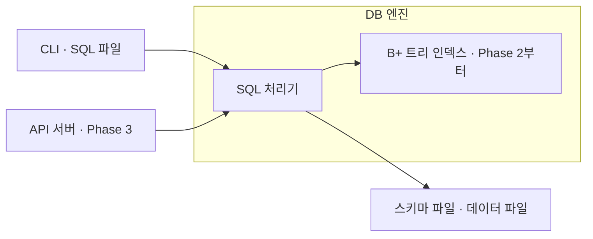
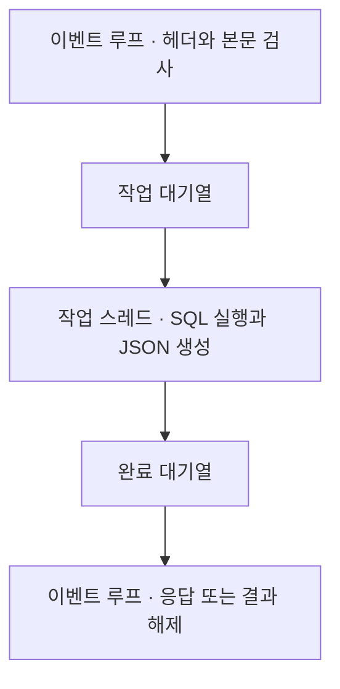

# 미니 DBMS PRD

**작성자** 안다빈 · **상태** 팀 회의 전 개인 PRD 초안

[회의 안건](#회의-안건) · [Phase 1](#5-phase-1-sql-처리기) · [Phase 2](#6-phase-2-b-트리-인덱스) · [Phase 3](#7-phase-3-api-서버) · [테스트](#8-테스트와-완료-확인)

[요구사항](../requirements.md)에서 LMS 항목 번호를, [용어집](../../GLOSSARY.md)에서 프로젝트 용어를 확인할 수 있습니다.

## 1. 목표와 Phase별 완료 조건

SQL로 레코드를 저장하고 조회하는 파일 기반 DB를 만듭니다. 같은 엔진에 ID 인덱스를 붙여 100만 건에서 조회 속도를 비교하고, 마지막에는 API 서버에서 여러 클라이언트의 요청을 처리합니다.

| Phase | 해결할 문제 | 완료 조건 |
| --- | --- | --- |
| 1. SQL 처리기 | SQL 문장을 이해하고 실행하기 | CLI로 SQL 파일을 받아 `INSERT`는 데이터 파일에 저장하고 `SELECT`는 데이터 파일에서 읽어 출력합니다. |
| 2. B+ 트리 인덱스 | 100만 건에서 ID로 빠르게 찾기 | Phase 1의 SQL 처리기로 100만 건 이상을 삽입합니다. ID 조회는 B+ 트리를 쓰고, 다른 필드 조회는 모든 레코드를 읽습니다. 두 경로의 속도를 비교합니다. |
| 3. API 서버 | 여러 클라이언트의 요청을 병렬로 처리하기 | 외부 클라이언트가 HTTP로 DB 기능을 씁니다. 스레드 풀이 DB 엔진으로 요청을 처리하고, 동시 읽기·쓰기 중에도 데이터가 일관되게 유지됩니다. |

## 회의 안건

| 결정할 항목 | 제안 | 합의가 필요한 이유 |
| --- | --- | --- |
| HTTP 라이브러리 | Mongoose 7.23과 배포 라이선스 확인 | 연결 재사용과 스레드 간 알림의 동작을 이 버전 기준으로 확인했습니다. 배포 전에 라이선스 조건을 확인합니다. [Phase 3 환경](#4-환경) |
| 저장 형식 | 탭 구분 데이터 파일과 스키마 파일 | 세 Phase가 같은 파일을 사용합니다. [저장 형식](#52-저장-형식-l36) |
| 엔진 인터페이스 | 문장 하나를 실행하고 결과 구조체를 반환합니다. CLI는 다음 문장 위치도 받습니다. | CLI, API 서버, 테스트가 함께 쓰는 경계입니다. [엔진 인터페이스](#33-엔진-인터페이스-l43) |
| 동시성 제어 | 엔진 전체에 쓰기 우선 읽기·쓰기 잠금 하나 | 긴 조회와 삽입이 서로 얼마나 기다리는지에 영향을 줍니다. [동시성 제어](#71-동시성-제어-l42) |
| API 형식 | `POST /query`, JSON 응답, HTTP/1.1 연결 재사용 | 클라이언트와 기능 테스트가 이 규약을 따릅니다. [API 형식](#73-api-형식) |
| 용어 | 레코드·필드, SQL 처리기, DB 엔진 | LMS와 팀 문서에서 같은 개념을 같은 이름으로 설명할지 확인합니다. [용어집](../../GLOSSARY.md) |

결과 상한은 10,000건으로 시작합니다. 본문·결과 바이트 상한과 작업 대기열 길이는 구현할 때 정합니다.

추가 구현에 시간이 남으면 성능 비교 그래프, 스냅샷 읽기, 범위 비교, 오른쪽 끝 분할, REPL을 검토합니다(L34). 접근 경로·읽은 레코드 수·걸린 시간 표시는 이 초안에 포함했습니다. 회의에서 확정한 결정 중 되돌리기 어려운 항목은 [팀 규칙](../../CONVENTION.md#adr)에 따라 ADR로 남깁니다.

## 2. 전체 구조

CLI는 파일에서, API 서버는 HTTP 요청에서 SQL을 꺼내 같은 엔진에 넘깁니다. SQL 처리기는 문장을 파싱하고 실행해 데이터 파일을 읽거나 씁니다. Phase 2에서는 여기에 ID를 찾는 B+ 트리 인덱스를 붙입니다.



LMS L2의 “SQL 처리기 (CLI + 파일 기반 저장)”는 Phase 1의 구현 범위를 설명하는 표현으로 읽었습니다. L8의 CLI는 SQL을 전달하고, L35의 처리기는 SQL을 실행합니다. 팀에서 합의하면 이 해석을 [요구사항](../requirements.md)에 기록합니다.

## 3. 공통

### 3.1 SQL 지원 범위

```sql
INSERT INTO users VALUES ('kim', 'kim@example.com', 20);
SELECT * FROM users;
SELECT name, age FROM users WHERE id = 3;
SELECT * FROM users WHERE email = 'kim@example.com';
```

| 항목 | 지원 범위 |
| --- | --- |
| 문장 | `INSERT`, `SELECT` (L10) |
| `INSERT` | `INSERT INTO 테이블 VALUES (값, …);` 필드 목록은 적지 않습니다. `VALUES`에는 `id`를 뺀 필드의 값을 스키마 순서대로 모두 적습니다. |
| `SELECT` | `SELECT (* 또는 필드목록) FROM 테이블 [WHERE 필드 = 값];` `FROM`은 필수이고 `WHERE`만 생략할 수 있습니다. `WHERE`는 필드 하나와 `=` 비교 하나입니다. |
| 키워드 | 대소문자를 구분하지 않습니다(`select` = `SELECT`). |
| 테이블·필드 이름 | 대소문자를 구분합니다. |
| 문자열 값 | 작은따옴표로 감쌉니다. 값 안의 작은따옴표는 `''`로 적습니다(`'O''Brien'`). |
| 주석 | 문자열 밖에서 `--`를 만나면 그 줄 끝까지 건너뜁니다. |
| `;` | 모든 문장 끝에 필수입니다. 문자열·주석 안에 있는 `;`는 문장을 끝내지 않습니다. |

**검증 순서.** 실행기는 테이블과 필드가 있는지, 값 개수와 자료형이 스키마와 맞는지를 먼저 확인합니다. 모든 필드에 같은 규칙을 적용합니다. 예를 들어 `id = 'abc'`와 `age = 'x'`는 둘 다 타입 오류이고, 전체 탐색으로 넘어가지 않습니다. 접근 경로(Phase 2)는 이 검증을 통과한 `SELECT`에만 고릅니다.

**범위 밖.** `UPDATE`, `DELETE`, `CREATE TABLE`(L19), `INSERT`의 필드 목록, `JOIN`, `ORDER BY`, 집계 함수, `AND`·`OR`·범위 비교, `NULL`, 트랜잭션, 디스크 기반 B+ 트리(L21), 비정상 종료 뒤의 완전한 복구, 사용자 인증과 권한. 테이블과 스키마는 미리 준비합니다(L18).

### 3.2 자료형과 ID

| 항목 | 규칙 |
| --- | --- |
| `INT` | 64비트 부호 있는 정수입니다. 범위를 넘는 숫자는 오류입니다. |
| `TEXT` | 스키마에 필드별 길이 제한을 두지 않습니다. API 요청·결과에는 별도 상한이 있습니다. |
| `NULL` | 지원하지 않습니다. `INSERT`가 모든 필드의 값을 요구하므로 필요하지 않습니다. |
| `id` | 모든 테이블에 자동으로 있는 첫 필드(`INT`)입니다. 스키마 파일에는 적지 않고, 적으면 스키마 오류입니다. |
| ID 부여 | 1부터 시작해 1씩 늘고, 테이블마다 따로 셉니다(L22). 사용자는 ID를 정할 수 없습니다. |
| 실패한 `INSERT` | 삽입 전 상태가 유지됐거나 되돌리기에 성공하면 ID를 소비하지 않습니다. |
| 표시 | `SELECT *`의 첫 필드로 `id`가 나옵니다. |

### 3.3 엔진 인터페이스 (L43)

```c
struct engine *engine_create(const char *data_dir,
                             const struct engine_options *options);
struct engine_result *engine_execute(struct engine *engine, const char *sql,
                                     const char **next_sql);
void engine_result_destroy(struct engine_result *result);
void engine_destroy(struct engine *engine);
```

`engine_execute()`는 한 번에 문장 하나만 실행합니다. 세 번째 인자로 두 가지 모드를 고릅니다.

| 입력 | CLI 모드 (`&next_sql`을 넘김) | API 모드 (`NULL`을 넘김) |
| --- | --- | --- |
| 빈 입력, 또는 공백과 `--` 주석만 있음 | 문장 없음 → CLI는 정상 종료 | 문장 없음 → `400` |
| 문장 하나 뒤에 공백과 주석만 있음 | 문장을 실행하고, 다음 호출에서 문장 없음 | 문장을 실행 |
| 문장 하나 뒤에 다른 문장이나 잘못된 토큰이 있음 | 첫 문장을 실행하고, 나머지는 다음 호출에서 처리 | **실행 전에** `400` → 파일이 바뀌지 않음 |

- CLI 모드에서는 파서가 문장이 끝난 곳을 `next_sql`로 알려 줍니다. CLI는 그 위치부터 다음 문장을 넘깁니다. 그래서 문자열 안의 `;`에서 문장이 잘리지 않습니다.
- 실행 결과는 성공, 문장 없음, 오류 중 하나의 상태를 담습니다. 성공한 `SELECT`는 필드 이름, 레코드, 접근 경로, 읽은 레코드 수를 담습니다. 성공한 `INSERT`는 추가한 레코드 수와 발급한 ID를 담습니다. 문장 없음은 결과가 0건인 `SELECT` 성공과 구분합니다.
- 엔진은 실행 결과를 반환합니다. 결과 구조체를 할당할 수 없으면 `NULL`을 반환합니다. CLI와 서버는 결과를 다 쓴 뒤 `engine_result_destroy()`로 해제합니다.
- 엔진은 SQL 검증과 실행, 공유 데이터의 잠금을 맡습니다. 서버는 HTTP 요청에서 SQL을 꺼내 엔진에 전달하고 결과를 JSON으로 바꿉니다.
- `engine_options`에는 결과 상한(레코드 수, 누적 바이트)이 들어갑니다. CLI는 상한을 두지 않고(0), 서버는 설정값을 넘깁니다. 상한을 넘으면 엔진은 모으기를 멈추고, 모은 레코드를 해제한 뒤 오류를 돌려줍니다.

CLI와 서버가 같은 결과를 받아 각각 TSV와 JSON으로 출력할 수 있도록 결과 구조체를 씁니다. 전체 조회의 메모리 사용량은 Phase 2에서 별도로 확인합니다.

<details>
<summary>검토한 결과 전달 방식</summary>

엔진이 직접 출력하면 호출부마다 다른 출력 형식을 쓰기 어렵습니다. 레코드마다 콜백을 부르면 결과를 한꺼번에 모으는 비용은 줄어들지만, 콜백을 잠금 안에서 실행하면 다른 요청이 오래 기다릴 수 있습니다.

</details>

### 3.4 `INSERT`의 성공과 실패

레코드 전체를 파일에 쓰고, Phase 2부터는 인덱스에도 등록한 뒤 성공을 반환합니다. 다음 ID는 이때 올립니다.

```text
값 검증과 성공 응답에 필요한 엔진 결과 구조체 준비
  → 파일의 기존 길이 기록 → 레코드 전체 덧붙이기
  → Phase 2부터 B+ 트리에 ID와 위치 등록 → 다음 ID 갱신 → 성공
```

- `write()`가 일부만 쓰면 남은 바이트를 이어 씁니다. `EINTR`로 중단되면 다시 시도합니다.
- 끝까지 쓰지 못했거나 인덱스 등록에 실패하면, 파일을 변경 전 길이로 되돌립니다(`ftruncate()`). B+ 트리는 삽입에 필요한 노드를 모두 할당한 뒤 변경하므로, 등록이 실패하면 기존 트리는 그대로입니다.
- 되돌리기에 성공하면 이번 ID를 소비하지 않습니다. 되돌리기까지 실패하면 현재 엔진에서 해당 테이블의 조회와 쓰기를 멈추고 오류를 반환합니다.
- `fsync()`는 호출하지 않습니다. 레코드마다 디스크 기록을 기다리면 100만 건 삽입(L24)이 크게 느려지기 때문입니다. 그 대신 전원 장애 시 아직 디스크에 기록되지 않은 레코드를 잃을 수 있습니다.

## 4. 환경

mini-redis의 개발 환경을 재사용합니다. `DA` 브랜치에 초기 환경을 구성했고 `make verify` 통과를 확인했습니다.

| 항목 | 내용 |
| --- | --- |
| 언어 | C11. 현재 개발 환경과 팀 코드 규칙의 기준입니다. |
| 빌드 | Makefile. 엔진은 `main()` 밖에 두고 CLI, 서버, 테스트, 측정 프로그램이 함께 링크합니다. |
| 검증 | `make verify`: 경고를 오류로 보는 빌드, ASan·UBSan 단위 테스트, 기능 테스트, ID 검사, 코드 규칙 검사. CI(`ubuntu-latest`)도 같은 명령을 씁니다. |
| 코드 규칙 | mini-redis와 같은 `.clang-format`, `.clang-tidy` |
| 테스트 도구 | acutest(C 단위 테스트), Python(기능 테스트) |
| Phase 2에 추가 | `make bench`: sanitizer를 끈 `-O2` 빌드로 측정 프로그램을 만듭니다. `scripts/gen_sql.py`: 측정용 SQL 파일을 만듭니다. |
| Phase 3에 추가 | `-pthread`, `make tsan`(ThreadSanitizer 빌드), Mongoose 7.23 도입 및 배포 라이선스 확인(회의 안건) |
| 플랫폼 | 쓰기 우선 rwlock 설정(7.1절)은 Linux/glibc 전용입니다. macOS에서는 기본 rwlock 동작을 따릅니다. |

C로 B+ 트리의 메모리 배치와 레코드의 파일 위치를 직접 다룹니다. 스레드 풀과 잠금에는 `pthread`를 쓰고, 빌드와 검사 도구는 mini-redis에서 쓰던 것을 가져옵니다.

## 5. Phase 1. SQL 처리기

### 5.1 SQL 파싱과 실행 (L35, L37)

**핵심 문제.** 사람이 쓴 SQL 문장을 실행기가 다룰 수 있는 구조로 바꾸고, 틀린 문장은 어디가 틀렸는지 알려 줘야 합니다.

- 토크나이저와 재귀 하강 파서(문법 규칙 하나를 함수 하나로 옮겨 쓰는 파서)를 직접 작성합니다. 지원 문법이 작아서 생성기 없이도 구현하고 설명할 수 있습니다(L32).
- 토큰마다 줄과 칸 위치를 저장합니다. 문법 오류는 줄 번호와 기대한 토큰을 알려 줍니다. 예: `2번째 줄: VALUES 다음에 '('가 와야 합니다`.
- 파서는 문장 종류, 테이블 이름, 필드 목록, 값 목록, `WHERE` 조건을 `struct statement`에 담습니다. 실행기는 이 구조체만 보고 SQL 문자열을 다시 보지 않습니다.

```
"SELECT name FROM users WHERE id = 3;"
   ↓ 토크나이저
[SELECT] [name] [FROM] [users] [WHERE] [id] [=] [3] [;]
   ↓ 파서
statement { type: SELECT, table: "users", fields: ["name"], where: { field: "id", value: 3 } }
   ↓ 실행기
검증 → (Phase 1) 모든 레코드를 읽어 조건 확인 / (Phase 2) B+ 트리로 위치를 찾아 그 레코드만 읽기
```

<details>
<summary>검토한 파서 구현 방식</summary>

| 대안 | 판단 |
| --- | --- |
| flex + bison | 문법 정의는 짧습니다. 하지만 로컬과 CI에 도구를 설치해야 하고, 생성 코드의 경고, 재진입(여러 스레드에서 동시에 호출해도 안전함) 설정, 오류 경로의 누수 처리(`%destructor`)를 따로 맞춰야 합니다. |
| Lemon | SQLite가 쓰는 파서 생성기로, 기본이 재진입 가능하고 C 파일 하나라 bison보다 도입이 쉽습니다. 토크나이저는 직접 작성합니다. |
| `strtok`, `sscanf` | 구분 문자만으로 나누면 문자열 값 안의 공백, 쉼표, `;`까지 잘못 자를 수 있습니다. |

</details>

실행기는 파서가 만든 `struct statement`를 사용합니다. 나중에 생성기를 도입하더라도 이 호출 인터페이스를 유지하는 방향으로 검토합니다.

### 5.2 저장 형식 (L36)

**핵심 문제.** 사람이 열어 볼 수 있고, 레코드를 빠르게 덧붙일 수 있고, 특정 레코드로 바로 건너뛸 수 있는 형식이 필요합니다.

| 파일 | 형식 |
| --- | --- |
| `<data 폴더>/<테이블>.schema` | 스키마 파일. 사람이 미리 만듭니다. 한 줄에 `name TEXT`, `age INT`처럼 필드 하나를 적습니다. 빈 줄은 무시하고, 형식이 틀린 줄은 줄 번호와 함께 스키마 오류입니다. 테이블 이름은 파일 이름이고 대소문자를 구분합니다. |
| `<data 폴더>/<테이블>.tbl` | 데이터 파일. 한 줄에 레코드 하나, 필드는 탭으로 구분하고 첫 필드는 `id`입니다. `TEXT` 안의 탭, 줄바꿈, 역슬래시는 `\t`, `\n`, `\\`로 저장합니다. **모든 레코드는 `\n`으로 끝납니다.** |
| `<data 폴더>/.lock` | 잠금 파일. 5.3절 |

```text
1	kim	kim@example.com	20
2	lee	lee@example.com	31
```

`INSERT`는 데이터 파일 끝에 레코드를 덧붙이고, 이미 있는 줄은 고치지 않습니다. 레코드마다 길이가 다르므로 Phase 2에서는 레코드가 시작하는 바이트 위치를 B+ 트리에 저장합니다.

탭 구분 텍스트를 선택하면 에디터에서 데이터를 바로 확인할 수 있고, 테스트 입력도 손으로 만들 수 있습니다. 삽입이 성공하는 조건은 [3.4절](#34-insert의-성공과-실패)을 따릅니다.

<details>
<summary>검토한 파일 형식</summary>

| 형식 | 판단 |
| --- | --- |
| 탭 구분 텍스트 (선택) | 사람이 파일을 열어 볼 수 있고, 테스트용 고정 데이터를 손으로 쓸 수 있습니다. 이스케이프 규칙은 세 가지입니다. 대신 읽을 때 문자열을 해석하는 비용이 SCAN 시간에 들어갑니다. |
| CSV | 쉼표, 따옴표, 줄바꿈이 든 값의 규칙이 더 복잡합니다. |
| 고정 길이 바이너리 | `TEXT`에 최대 길이가 필요합니다(3.2절과 맞지 않음). 또 `(id - 1) × 레코드 크기`로 위치를 계산할 수 있어, 인덱스가 왜 필요한지 보여 주기 어렵습니다. |
| 가변 길이 바이너리 | 문자열 이스케이프와 정수의 텍스트 변환을 줄일 수 있습니다. 사람이 내용을 보려면 덤프 도구가 필요합니다. |

</details>

### 5.3 시작과 파일 잠금

엔진을 만들 때(`engine_create`) 아래 순서로 준비합니다.

```
<data 폴더>/.lock에 비차단 배타 flock → 스키마 파일 읽기 → 데이터 파일을 한 번 훑기
  → 다음 ID 정하기 → (Phase 2부터) ID와 위치로 B+ 트리 만들기
```

1. **잠금.** 스키마 파일과 데이터 파일을 읽기 전에 잠급니다. 이미 잠겨 있으면 "다른 프로세스가 사용 중" 오류로 끝냅니다. 그래서 CLI 두 개, 또는 서버와 CLI가 같은 폴더에서 같은 ID를 주는 일이 생기지 않습니다. 잠금은 프로세스가 끝나면 저절로 풀리므로, 비정상 종료 뒤에도 다음 실행을 막지 않습니다.
2. **모든 테이블을 한 번에 준비.** data 폴더의 모든 테이블을 엔진을 만들 때 한 번에 훑습니다. 스키마와 다음 ID를 메모리에 보관하고, Phase 2부터는 인덱스도 보관합니다. 레코드 본문은 조회할 때 데이터 파일에서 읽습니다. 엔진이 만들어진 뒤에는 "처음 쓰는 테이블을 읽어 올리기"가 없으므로, Phase 3의 잠금이 단순해집니다.
3. **데이터 파일 검사.** 테이블마다 스키마 파일과 데이터 파일을 미리 준비합니다. 비어 있는 `.tbl`은 정상이며 첫 ID는 1입니다. 기존 레코드가 있으면 가장 큰 ID 다음 번호부터 시작합니다. ID가 `INT`의 최댓값에 도달한 테이블에서 새 `INSERT`는 오류로 처리합니다. 데이터 파일이 없거나 비어 있지 않은 파일의 마지막 레코드에 `\n`이 없으면 오류로 시작을 중단합니다. 잘린 레코드 오류에는 파일 이름과 줄 번호를 표시합니다. 엔진은 그 줄이 쓰다 남은 조각인지 줄바꿈만 빠진 정상 레코드인지 구분할 수 없으므로 파일을 고치지 않습니다.

### 5.4 CLI (L38, L8)

```bash
./build/mini-dbms [--data <폴더>] <sql-file>
```

| 항목 | 동작 |
| --- | --- |
| 입력 | SQL 파일 경로 하나. `--data`를 생략하면 `data/`를 씁니다. 테스트는 임시 폴더를 넘깁니다. CLI는 파일 전체를 메모리에 읽어 `engine_execute()`에 CLI 모드로 넘깁니다. 파일에 NUL 바이트(`0x00`)가 있으면 입력 오류로 처리합니다. |
| 실행 | 위에서부터 한 문장씩 실행합니다. 문장 없음이 나오면 정상 종료합니다. |
| 오류 | 첫 오류에서 멈추고, 위치와 이유를 stderr에 출력합니다. 트랜잭션이 없으므로 오류 앞에서 성공한 `INSERT`는 파일에 남습니다. |
| `SELECT` 출력 | stdout에 TSV로 출력합니다. 첫 줄은 필드 이름이고, 값은 저장 형식과 같은 세 가지 이스케이프를 씁니다. 결과가 0건이면 필드 이름 줄만 출력합니다. |
| 메타 정보 | stderr에 한 줄로 출력합니다. `INSERT`는 `-- 1 record inserted, id 3`입니다. `SELECT`의 경로는 Phase 1에서 `SCAN`, Phase 2부터는 조건에 따라 `INDEX` 또는 `SCAN`입니다. Phase 2 출력 예는 `-- 1 record, INDEX, examined 1, 0.02 ms`입니다. |
| 종료 코드 | `0` 성공, `1` 파일·SQL·실행 오류(SQL 파일을 열 수 없음, 잠금 파일이 잠겨 있음 포함), `2` 잘못된 CLI 인자 |

REPL(한 줄씩 입력받아 실행하는 대화형 모드)은 범위 밖이며 차별점 후보입니다. 엔진을 바꾸지 않고 CLI에만 붙일 수 있습니다.

## 6. Phase 2. B+ 트리 인덱스

### 6.1 B+ 트리 (L21, L39)

| 항목 | 규칙 |
| --- | --- |
| 키와 값 | 키는 ID(`int64`), 값은 데이터 파일 안의 위치(`uint64`)입니다. 메모리에만 둡니다(L21). |
| 모듈 경계 | 테이블을 모르는 일반 모듈("`int64` 키 → `uint64` 값")로 만들어, 엔진 없이 단위 테스트합니다. |
| 노드 크기 | 노드 하나의 최대 키 수는 32입니다. 내부 노드의 자식은 최대 33개입니다. 상수로 두고 측정으로 정합니다. |
| 분할 | 넘치면 반씩 나눕니다. |
| 리프 연결 | 리프끼리 다음 리프를 가리킵니다. 테스트의 키 순서 검사에 쓰고, 범위 비교 차별점의 바탕이 됩니다. |
| 삭제, 중복 키 | 없습니다. `DELETE`가 범위 밖이고 ID는 겹치지 않습니다. |
| 실패 처리 | 삽입에 필요한 노드를 먼저 할당하므로, 실패하면 트리가 바뀌지 않습니다(3.4절). |

ID가 오름차순으로 들어오면 분할 뒤에도 새 ID는 오른쪽 리프에만 들어갑니다. 왼쪽 리프는 절반 정도 찬 상태로 남습니다. 반씩 분할하는 방식으로 시작하고 리프 수·트리 높이·메모리 사용량은 실제로 측정합니다. 오른쪽 끝 분할은 메모리 사용량을 줄일 필요가 있을 때 검토합니다.

### 6.2 실행기 연결 (L41)

| 동작 | 실행기 처리 순서 |
| --- | --- |
| `INSERT` | 3.4절의 순서 |
| `SELECT … WHERE id = 정수` | 검증 → B+ 트리에서 위치 찾기 → 그 레코드만 `pread`로 읽기 → 요청한 필드 반환. 접근 경로 `INDEX` |
| 그 밖의 `SELECT` | 검증 → 모든 레코드 읽기 → 조건에 맞는 레코드에서 요청한 필드 반환. 접근 경로 `SCAN` |
| 없는 ID | 접근 경로 `INDEX`, 결과 0건, `records_examined = 0` |

실행기는 `INSERT`에서 인덱스를 갱신하고 `SELECT`에서 사용합니다. 재시작할 때는 인덱스를 다시 만듭니다(5.3절). Phase 1의 SQL 문법과 실행 방법을 그대로 쓰며, 테스트는 접근 경로와 읽은 레코드 수를 확인합니다(L48).

### 6.3 데이터 생성과 성능 비교 (L40, L25, L26, L24)

**핵심 문제.** 100만 건을 손으로 만들 수 없고, 측정할 때마다 같은 데이터를 써야 결과를 비교할 수 있습니다.

1. **데이터.** 측정용 테이블은 `users(name TEXT, email TEXT, age INT)`입니다. `scripts/gen_sql.py --rows 1000000 --seed 1`이 `INSERT` 문 100만 개가 든 SQL 파일을 만듭니다. 시드가 같으면 같은 데이터가 나옵니다. `email`은 번호로 만들어(`user0000123@example.com`) 값이 겹치지 않습니다.
2. **삽입.** 측정마다 빈 테이블에서 시작합니다. 생성한 SQL 파일을 CLI로 실행해 같은 테이블에 100만 건 이상을 일반 `INSERT` 경로로 넣습니다(L24, L26).
3. **측정 프로그램.** `make bench`가 엔진을 직접 링크한 측정 프로그램을 만듭니다. 조회 시간은 엔진 준비가 끝난 뒤부터 재므로, 시작할 때의 인덱스 재구성 시간과 터미널 출력이 들어가지 않습니다. 재구성 시간은 따로 적습니다.
4. **비교 질의.** 같은 레코드 하나를 `WHERE id = k`와 `WHERE email = '<k의 email>'`로 각각 찾습니다. 두 질의가 같은 필드의 같은 레코드 1건을 반환하도록 맞춥니다. 실행 시간에는 각 접근 경로의 파일 읽기와 정수·문자열 비교 비용이 포함됩니다. 엔진은 `email`에 같은 값이 더 없다는 것을 모르므로 SCAN은 100만 건을 모두 읽습니다.
5. **횟수와 통계.** 같은 엔진 세션에서 두 경로를 미리 한 번씩 실행한 뒤, SQL 문장 하나를 넘겨 결과를 받기까지 잽니다. `INDEX`는 1,000번 재서 중앙값과 p99(99번째 백분위수)를, `SCAN`은 30번 재서 중앙값, 최솟값, 최댓값을 적습니다. SCAN의 반복 횟수는 전체 측정 시간을 줄이기 위해 적게 잡았습니다.
6. **함께 적을 것.** 읽은 레코드 수, B+ 트리의 높이와 메모리, 저장 형식(텍스트 해석 비용이 SCAN에 들어감)을 측정 기록에 적습니다.

## 7. Phase 3. API 서버

### 7.1 동시성 제어 (L42)

**핵심 문제.** 작업 스레드 여러 개가 같은 B+ 트리와 데이터 파일을 함께 씁니다. 한 스레드가 노드를 나누는 도중에 다른 스레드가 트리를 읽으면 반쯤 바뀐 트리를 보게 됩니다.

- 엔진 전체에 `pthread_rwlock`(읽기·쓰기 잠금) 하나를 **쓰기 우선**으로 둡니다. 여러 `SELECT`는 읽기 잠금으로 동시에 돌고, `INSERT`는 쓰기 잠금으로 하나씩 실행합니다. 테이블은 엔진을 만들 때 모두 준비되어 있고(5.3절) 과제에 필요한 테이블은 하나 정도이므로, 테이블별 잠금은 엔진 전체 잠금과 사실상 같습니다.
- 쓰기 우선으로 두는 이유는 glibc의 기본 rwlock이 읽기를 우선하기 때문입니다. `SELECT`가 끊이지 않으면 `INSERT`가 끝없이 기다릴 수 있습니다(쓰기 굶주림). 쓰기 우선 설정(`PTHREAD_RWLOCK_PREFER_WRITER_NONRECURSIVE_NP`)은 Linux/glibc 전용이고 `_GNU_SOURCE`가 필요합니다. 이 설정에서는 읽기 잠금을 쥔 스레드가 읽기 잠금을 다시 잡으면 쓰기가 대기 중일 때 교착할 수 있으므로, 엔진 안에서 잠금을 다시 잡는 경로를 두지 않습니다.
- 잠금은 실행 단계에서만 쥡니다. 토크나이저·파서와 JSON 만들기는 공유 데이터를 건드리지 않으므로 잠금 밖에서 합니다.
- ID 부여, 파일 끝에 쓰기, B+ 트리 등록, 실패했을 때의 되돌리기(3.4절)는 모두 같은 쓰기 잠금 안에서 합니다.
- 조회마다 독립된 읽기 위치를 씁니다. 레코드를 읽을 때 `pread`(파일 위치를 바꾸지 않고 지정한 곳에서 읽는 함수)를 씁니다. `FILE *` 하나에 `fseek` 후 읽으면, 두 스레드가 모두 읽기 잠금을 쥐고 있어도 서로의 읽을 위치를 바꿀 수 있습니다.
- 프로세스끼리는 잠금 파일(5.3절)이 막습니다. 엔진 안의 rwlock은 같은 프로세스 안의 스레드만 막습니다.

<details>
<summary>검토한 잠금 방식</summary>

| 대안 | 판단 |
| --- | --- |
| 기본 설정 rwlock | 가장 단순하지만 쓰기 굶주림으로 동시성 테스트가 시간 초과로 실패할 수 있습니다. |
| 스냅샷 읽기 | 잠금은 B+ 트리, 다음 ID, 확정된 파일 길이를 다루는 짧은 순간에만 쥐고, SCAN은 시작할 때의 확정 길이까지만 잠금 없이 읽습니다. 데이터 파일이 덧붙이기만 하므로 성립합니다. `INSERT`가 SCAN을 기다리지 않는 대신 순서 규칙이 하나 늘어납니다. `engine_execute()`는 바뀌지 않으므로 차별점 후보로 둡니다. |
| 테이블별 잠금, 노드 단위 잠금 | `INSERT`끼리도 병렬로 돌 수 있지만 구현과 검증 비용이 큽니다. |

</details>

### 7.2 요청 처리 흐름 (L44, L29)

이벤트 루프가 HTTP 요청을 받고 응답을 보냅니다. 작업 스레드는 SQL을 실행하고 JSON 결과를 완료 대기열에 넣습니다. HTTP에는 Mongoose 7.23을 제안하고, 스레드 풀과 대기열은 직접 구현합니다.



- 헤더에서 거절한 요청과 선언한 길이만큼 본문을 받지 못한 요청은 실행하지 않습니다. 검사를 통과한 SQL만 복사해 작업 대기열에 넣습니다. 대기열이 가득 차면 `503`으로 답합니다.
- 완료 항목에는 연결 번호, HTTP 상태 코드, JSON을 담습니다. `mg_wakeup()`은 이벤트 루프를 깨우는 데만 쓰고, 이벤트 루프는 매 poll에도 완료 대기열을 확인합니다. 살아 있는 연결에는 최종 응답을 한 번 보내며, 연결이 끊긴 경우에는 결과를 해제합니다.
- HTTP/1.1 연결은 재사용합니다. 같은 연결에 들어온 다음 요청은 앞 응답을 **송신 버퍼에 넣은 뒤** 처리합니다. 여러 연결의 요청은 병렬로 처리할 수 있습니다.
- `Connection: close` 요청, keep-alive를 요청하지 않은 HTTP/1.0 요청, 또는 서버에서 닫기로 한 연결은 응답에 `Connection: close`를 넣습니다. 송신 버퍼에 응답을 넣은 뒤 `is_draining`으로 닫고, 해당 연결에서는 후속 SQL을 접수하지 않습니다.

<details>
<summary>Mongoose 7.23 구현 메모</summary>

- 작업 스레드에서는 `mg_wakeup()`만 호출합니다. 연결 조회와 `mg_http_reply()`는 이벤트 루프에서 수행합니다. 이벤트 루프가 시작할 때 `mg_wakeup_init()`을 호출합니다. `mg_wakeup()`에는 작은 신호만 보내고, 신호가 전달되지 않아도 완료 결과는 완료 대기열에 남습니다. 7.23의 `mg_wakeup()`은 데이터를 UDP 소켓 쌍으로 보내면서 `send()` 결과를 확인하지 않고, 받는 쪽은 살아 있는 연결에만 이벤트를 전달합니다. 그래서 결과나 포인터를 신호에 실으면 큰 결과는 전달되지 않고, 끊긴 연결의 결과는 해제되지 않습니다.
- Mongoose는 요청을 넘길 때 `is_resp`를 설정하고, `mg_http_reply()`가 응답을 송신 버퍼에 넣으면 이를 해제합니다. 앱이 이 플래그를 직접 변경하지 않습니다. 버전을 올릴 때는 같은 연결에서 요청을 연달아 처리하는 테스트로 동작을 확인합니다. [요청 처리와 응답 함수](https://github.com/cesanta/mongoose/blob/7.23/src/http.c)
- 요청 헤더는 작업 결과가 돌아올 때까지 보관되지 않습니다. 연결을 닫아야 하는지는 접수할 때 기록하고, 비동기 응답을 보낼 때 적용합니다.

</details>

### 7.3 API 형식

| 항목 | 규칙 |
| --- | --- |
| 요청 | `POST /query`. 본문에는 SQL 문장 하나를 넣고 길이를 `Content-Length`로 밝힙니다. NUL 바이트(`0x00`)가 있는 본문은 `400`으로 거절합니다. |
| body 상한 | 서버 설정값입니다. `MG_EV_HTTP_HDRS`에서 유효한 `Content-Length`를 먼저 확인하고, `MG_EV_HTTP_MSG`에서 받은 본문도 확인합니다. 본문 상한은 헤더 공간을 감안해 Mongoose의 수신 버퍼 한도보다 작게 정합니다. 라이브러리 한도에 먼저 걸리면 연결이 닫힐 수 있습니다. |
| `SELECT` 성공 | `200`, `{"fields": ["id", "name"], "records": [[1, "kim"]], "access_path": "INDEX", "records_examined": 1}` |
| `INSERT` 성공 | `200`, `{"inserted": 1, "id": 3}` |
| 정수 | `INT`와 `id`는 JSON 숫자로 보냅니다. double로 바꾸지 않고 `int64` 그대로 씁니다. JavaScript `Number`에서 안전 정수 범위 `±(2^53 − 1)`를 벗어난 값은 정밀도를 잃을 수 있습니다(RFC 8259 6절). |
| 오류 body | `{"error": "<오류 이유>", "message": "<사람이 읽는 설명>"}`. 예: `{"error": "result_too_large", "message": "조회 결과가 설정된 상한을 넘습니다. WHERE로 범위를 줄이세요."}` |

| 상태 코드 | 오류 이유 (제안) | 언제 |
| --- | --- | --- |
| `400` | `invalid_body_length`, `invalid_sql_body`, `syntax_error`, `table_not_found`, `field_not_found`, `type_mismatch`, `value_count_mismatch`, `no_statement`, `multiple_statements`, `result_too_large` | 잘못된 본문 길이 헤더, NUL이 포함된 본문, SQL 오류, 빈 본문, 문장이 둘 이상, 결과 상한 초과 |
| `404` | `route_not_found` | `/query`가 아닌 경로 |
| `405` | `method_not_allowed` | `/query`에 `POST` 이외의 메서드 사용. `Allow: POST` 헤더를 함께 보냅니다. |
| `411` | `length_required` | 길이를 `Content-Length`로 밝히지 않고 chunked 방식으로 본문을 보낸 요청 |
| `413` | `body_too_large` | 헤더를 정상적으로 읽었고 선언된 본문 길이가 상한을 넘음 |
| `503` | `queue_full` | 작업 대기열이 가득 참 |
| `500` | `storage_error`, `table_unavailable`, `out_of_memory` | 데이터 파일 쓰기 실패, 되돌리기 실패로 멈춘 테이블, 메모리 부족 |

`Content-Length`와 `Transfer-Encoding`이 함께 오거나 길이 표기가 잘못된 요청은 거절합니다. Mongoose가 헤더를 먼저 거절한 경우 연결만 닫힐 수 있습니다. 본문이 비어 있고 SQL이 없으면 `400 no_statement`로 답합니다.

### 7.4 상한

| 상한 | 규칙 |
| --- | --- |
| 작업 대기열 상한 | 설정값입니다. 가득 차면 기다리게 하지 않고 바로 `503`으로 답합니다. |
| 결과 상한 | 엔진은 레코드를 모으면서 건수와 누적 바이트를, 서버는 JSON을 만들면서 응답 바이트를 확인합니다. `TEXT` 길이에 제한이 없어서 건수만으로는 크기가 정해지지 않고, JSON 이스케이프로 크기가 더 커질 수 있기 때문입니다. 넘으면 모은 결과를 해제하고 `400 result_too_large`로 답합니다. 건수의 시작값은 10,000이고 CLI에는 상한이 없습니다. |
| 작업 스레드 수 | 기본값은 CPU 코어 수이고 실행할 때 바꿀 수 있습니다. |

서버가 약속하는 것은 요청 하나의 크기(body 상한, 결과 상한)와 기다리는 요청 수(작업 대기열 상한)입니다. 완료 대기열과 연결별 송신 버퍼까지 포함한 서버 전체 메모리는 약속하지 않습니다(알려진 한계). 느린 클라이언트가 응답을 천천히 읽으면 송신 버퍼에 데이터가 쌓이고, 연결 수에는 상한이 없기 때문입니다.

### 7.5 종료

```
SIGINT → 새 연결과 요청 접수를 멈춤
  → 대기 중인 작업과 실행 중인 작업이 모두 끝날 때까지 이벤트 루프를 돌리며 완료 결과를 처리
  → 남은 응답 전송을 최대 5초 기다리고 연결을 닫음
  → 작업 스레드 정리 → Mongoose 매니저 해제 → 엔진 해제 → flock 해제
```

- 5초는 응답 전송을 기다리는 시간입니다. 긴 SCAN은 5초를 넘을 수 있으므로 종료 전체가 5초 안에 끝난다는 뜻이 아닙니다.
- 응답은 이벤트 루프만 보낼 수 있으므로, 작업이 끝날 때까지 이벤트 루프를 멈추지 않습니다.
- 작업 스레드는 `mg_wakeup(mgr, …)`을 부르므로, 작업 스레드가 모두 끝난 뒤에 Mongoose 매니저를 해제합니다. 순서가 반대이면 해제된 메모리를 씁니다.
- `INSERT`의 저장 성공 기준은 [3.4절](#34-insert의-성공과-실패)을 따릅니다. 클라이언트가 응답을 받기 전에 연결이 닫혀도 이미 성공한 `INSERT`는 남습니다.

<details>
<summary>검토한 서버 구현 방식</summary>

| 대안 | 판단 |
| --- | --- |
| 소켓과 HTTP까지 직접 구현 | HTTP 해석은 과제의 핵심이 아닌데 시간이 가장 많이 듭니다. |
| 스레드 풀이 내장된 HTTP 라이브러리 | 과제가 요구하는 스레드 풀 구성(L29)을 라이브러리가 대신합니다. |
| 요청마다 스레드 생성 | 요청이 몰리면 스레드가 요청 수만큼 늘어납니다. |
| 결과를 `mg_wakeup`에 실어 보내기 | 알림 전달과 결과의 소유권을 분리할 수 있도록 완료 대기열을 씁니다(7.2절). |
| 연결마다 요청 하나를 받고 닫기 | 구현이 단순합니다. 현재 제안은 Mongoose 7.23의 순차 처리 동작을 이용해 연결을 재사용합니다. 매번 연결을 맺는 비용은 서버 처리량 측정에도 포함됩니다. |
| 서버 전체 메모리 상한 | 연결 수 상한과 연결별 요청 하나 제한을 직접 만들어야 합니다. 이 초안에서는 요청·결과·작업 대기열에 각각 상한을 둡니다(7.4절). |

</details>

## 8. 테스트와 완료 확인

| Phase | 검증할 내용 |
| --- | --- |
| 1 | 토크나이저·파서·저장 형식을 단위 테스트합니다. CLI를 다시 실행해도 레코드를 조회할 수 있고 ID가 이어지는지 확인합니다. |
| 2 | B+ 트리 단위 테스트: 오름차순 100만 키를 넣고 모두 찾습니다. 노드가 나뉘기 직전과 직후(키 32개, 33개)를 확인합니다. 테스트 전용 검사 함수로 모든 리프의 깊이가 같은지, 키가 오름차순인지, 키 수가 레코드 수와 같은지, 주요 ID가 올바른 파일 위치를 가리키는지 확인합니다. 6.3절의 성능 비교를 실행합니다. |
| 3 | Python 기능 테스트로 실제 서버에 HTTP 요청을 보냅니다. 동시성 테스트를 `make tsan`에서도 실행합니다. |

**인덱스 경로 확인 (L48)**

| 질의 예시 | 접근 경로 | 읽은 레코드 수 |
| --- | --- | --- |
| `WHERE id = 7` (있는 ID) | `INDEX` | 1 |
| `WHERE id = 1000001` (ID가 1부터 100만까지인 데이터에서 없는 ID) | `INDEX` | 0 |
| `WHERE email = 'kim@example.com'` | `SCAN` | 전체 레코드 수 |
| `WHERE id = 'abc'` | — | 타입 오류 |

**Phase 3 동시성 테스트**

1. **동시 `INSERT`.** 빈 테이블과 100건을 모두 받아 줄 수 있는 설정(작업 대기열 100 이상)에서 `INSERT` 100개를 동시에 보냅니다. 응답 순서와 상관없이 받은 ID의 집합이 1\~100인지 확인합니다. 각 `INSERT`에는 테스트가 만든 고유 표식을 넣고, 받은 ID로 다시 조회했을 때 그 표식이 나오는지 확인합니다. ID만 보면 번호가 맞아도 다른 요청의 데이터와 뒤바뀐 것을 놓칠 수 있기 때문입니다.
2. **SCAN과 `INSERT`를 섞기.** 반쯤 쓰인 레코드가 보이지 않는지, 조회한 `id`와 데이터가 실제로 넣은 짝과 맞는지 확인합니다.
3. **대기열이 가득 참.** 시간에 기대지 않도록 두 단계로 나눕니다. C 단위 테스트에서 작업 대기열 모듈을 작업 스레드 1개, 대기열 1칸으로 만들고, 테스트가 쥔 조건 변수로 첫 작업을 멈춰 둡니다. 둘째 작업이 대기열에 들어간 것을 확인한 뒤 셋째 작업이 거절되는지 봅니다. 그 다음 "가득 참 → `503`" 변환은 서버 쪽 단위 테스트에서 따로 확인합니다. 작업을 멈추는 제어는 테스트 코드에만 둡니다.

<details>
<summary>엣지 케이스 테스트 후보 (L50)</summary>

구현할 때 아래 동작을 각 테스트의 이름과 기대값에 반영합니다.

- SQL 입력: 빈 SQL 파일, 주석만 있는 파일, 마지막 `;` 빠짐, 문자열 안의 `;`, 없는 테이블과 필드, 값 개수 불일치, `INT` 자리에 문자열, 64비트를 넘는 숫자, 스키마 파일에 `id`를 적음
- 문자열: 작은따옴표(`''`)·탭·줄바꿈·역슬래시가 든 문자열, 아주 긴 문자열
- 조회: 빈 테이블, 없는 ID, 결과 0건과 문장 없음의 구분
- 파일: 마지막 줄이 `\n`으로 끝나지 않는 데이터 파일, 잠금 파일이 이미 잠긴 data 폴더, 쓰기 중 디스크 가득 참
- API: 문장 두 개가 든 body(첫 문장도 실행되지 않아야 함), 빈 body, chunked 요청, 상한을 넘는 body와 결과, NUL이 포함된 본문, 선언한 길이만큼 본문이 오기 전에 끊긴 연결, 응답 전에 끊긴 연결, 같은 연결에 요청을 연달아 보냈을 때의 응답 순서, 첫 요청에 `Connection: close`가 있을 때 두 번째 SQL이 실행되지 않는지 확인

</details>

## 9. 알려진 한계

- 전원이 꺼지면 운영체제가 아직 디스크에 쓰지 않은 레코드를 잃을 수 있습니다(`fsync` 없음).
- CLI가 첫 오류에서 멈춰도, 그 앞에서 성공한 `INSERT`는 남습니다(트랜잭션 없음).
- 되돌리기(`ftruncate`)까지 실패한 뒤 다시 시작하면, 실패를 알렸던 레코드가 파일에 온전히 남아 있어 보일 수 있습니다. 비정상 종료와 복구 실패 뒤에는 마지막 삽입의 상태를 보장하지 않습니다.
- 데이터 파일 끝이 잘려 있으면 사람이 고쳐야 다시 시작할 수 있습니다.
- 서버 전체 메모리에는 상한이 없습니다(7.4절).
- 쓰기 우선 rwlock은 Linux/glibc에서만 설정됩니다.
- JSON 정수는 JavaScript의 안전 정수 범위 `±(2^53 − 1)`를 벗어나면 클라이언트에서 정밀도를 잃을 수 있습니다.
